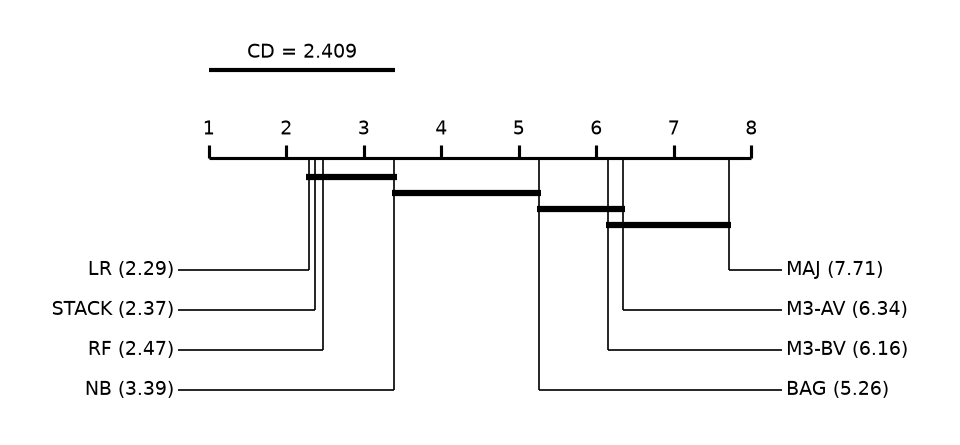

# Campagne 1 : analyse

- Résultats analysés : `resultats/campagne1`
- Script d'analyse : commit `9c85570b501918521e3296cdeaa90e5c87c104bb`, modifications non commitées : False
- Versions : scipy 1.18.1, numpy 2.5.0, pandas 3.0.3
- Date de l'analyse : 2026-11-19T16:48:24

**Campagne concluante (19 jeux terminés >= 15).**

## Anomalies de traçabilité

Signalées, non bloquantes : aucun pli n'est exclu pour cette raison.

Aucune.

Machines utilisées :

| processeur | plateforme | nb_plis |
|---|---|---|
| x86_64 | Linux-6.18.55+-x86_64-with-glibc2.39 | 190 |

## Jeux retenus (19)

iris, zoo, glass, wine, balance-scale, breast-cancer, hepatitis, heart-statlog, pima, breast-w, vote, colic, credit-approval, vowel, led7, nursery, anneal, page-blocks, mushroom

## Jeux non retenus

Aucun.

## Hypothèses H8 à H10

H8, H9 : Wilcoxon signé bilatéral (scipy, réglages par défaut), Holm sur les deux ; confirmée si p_holm < 0.05 et médiane(d) > 0. H10 : intervalle bootstrap percentile à 95 % de la moyenne de STACK - RF (10000 tirages, graine 42) ; confirmée si borne basse > -0.02.

| hypothese | comparaison | n_jeux | n_effectifs | mediane_d | moyenne_d | victoires | defaites | egalites | W | p_brut | p_holm | verdict | borne_basse | borne_haute |
|---|---|---|---|---|---|---|---|---|---|---|---|---|---|---|
| H8 | STACK - M3-BV | 19 | 19 | 0.2307 | 0.2021 | 19 | 0 | 0 | 0.0000 | 3.815e-06 | 7.629e-06 | confirmée |  |  |
| H9 | BAG - M3-BV | 19 | 15 | 0.0145 | 0.0221 | 13 | 2 | 4 | 8.0000 | 0.0031 | 0.0031 | confirmée |  |  |
| H10 | STACK - RF | 19 | 18 | -0.0031 | -0.0133 | 8 | 10 | 1 |  |  |  | rejetée | -0.0327 | 0.0043 |

## F1 macro par jeu (moyenne sur 10 plis)

Arrondie à 3 décimales ici ; valeurs exactes dans `f1_par_jeu.csv`.

| jeu | MAJ | M3-AV | M3-BV | STACK | LR | RF | NB | BAG |
|---|---|---|---|---|---|---|---|---|
| iris | 0.167 | 0.901 | 0.910 | 0.966 | 0.946 | 0.946 | 0.933 | 0.945 |
| zoo | 0.102 | 0.495 | 0.547 | 0.816 | 0.891 | 0.911 | 0.891 | 0.673 |
| glass | 0.089 | 0.338 | 0.299 | 0.571 | 0.618 | 0.591 | 0.548 | 0.333 |
| wine | 0.190 | 0.939 | 0.912 | 0.963 | 0.951 | 0.956 | 0.957 | 0.939 |
| balance-scale | 0.209 | 0.626 | 0.534 | 0.640 | 0.640 | 0.582 | 0.634 | 0.550 |
| breast-cancer | 0.413 | 0.413 | 0.412 | 0.667 | 0.613 | 0.648 | 0.659 | 0.413 |
| hepatitis | 0.442 | 0.442 | 0.442 | 0.712 | 0.719 | 0.705 | 0.749 | 0.442 |
| heart-statlog | 0.357 | 0.756 | 0.742 | 0.810 | 0.840 | 0.803 | 0.805 | 0.781 |
| pima | 0.394 | 0.426 | 0.479 | 0.710 | 0.714 | 0.685 | 0.713 | 0.475 |
| breast-w | 0.396 | 0.962 | 0.935 | 0.954 | 0.964 | 0.958 | 0.972 | 0.959 |
| vote | 0.380 | 0.882 | 0.931 | 0.951 | 0.961 | 0.954 | 0.897 | 0.928 |
| colic | 0.387 | 0.572 | 0.737 | 0.780 | 0.804 | 0.828 | 0.772 | 0.741 |
| credit-approval | 0.357 | 0.749 | 0.819 | 0.858 | 0.866 | 0.869 | 0.840 | 0.833 |
| vowel | 0.015 | 0.202 | 0.210 | 0.736 | 0.558 | 0.837 | 0.457 | 0.232 |
| led7 | 0.019 | 0.302 | 0.337 | 0.724 | 0.721 | 0.717 | 0.719 | 0.423 |
| nursery | 0.120 | 0.390 | 0.540 | 0.855 | 0.854 | 0.942 | 0.820 | 0.540 |
| anneal | 0.182 | 0.182 | 0.499 | 0.881 | 0.869 | 0.894 | 0.725 | 0.499 |
| page-blocks | 0.189 | 0.189 | 0.189 | 0.719 | 0.706 | 0.737 | 0.449 | 0.189 |
| mushroom | 0.341 | 0.900 | 0.996 | 1.000 | 1.000 | 1.000 | 0.942 | 0.997 |

## Friedman et Nemenyi (descriptif, sans verdict)

Friedman : chi2 = 102.661, p = 3.042e-19, N = 19 jeux, k = 8 méthodes. Nemenyi : CD = 3.031·√(k(k+1)/(6N)) = 2.409.

| methode | rang_moyen |
|---|---|
| LR | 2.289 |
| STACK | 2.368 |
| RF | 2.474 |
| NB | 3.395 |
| BAG | 5.263 |
| M3-BV | 6.158 |
| M3-AV | 6.342 |
| MAJ | 7.711 |

Groupes non distincts (rangs à moins de CD) : {LR, STACK, RF, NB}; {NB, BAG}; {BAG, M3-BV, M3-AV}; {M3-BV, M3-AV, MAJ}

## Non-couverts et égalités de M3-AV et M3-BV

| jeu | taux_non_couverts_M3-AV | taux_non_couverts_M3-BV | taux_egalites_M3-AV | taux_egalites_M3-BV |
|---|---|---|---|---|
| iris | 0.007 | 0.007 | 0.000 | 0.000 |
| zoo | 0.000 | 0.000 | 0.000 | 0.010 |
| glass | 0.000 | 0.000 | 0.000 | 0.000 |
| wine | 0.000 | 0.000 | 0.000 | 0.006 |
| balance-scale | 0.000 | 0.000 | 0.000 | 0.005 |
| breast-cancer | 0.000 | 0.000 | 0.000 | 0.000 |
| hepatitis | 0.000 | 0.000 | 0.000 | 0.000 |
| heart-statlog | 0.000 | 0.000 | 0.000 | 0.004 |
| pima | 0.000 | 0.000 | 0.000 | 0.000 |
| breast-w | 0.000 | 0.000 | 0.000 | 0.000 |
| vote | 0.007 | 0.007 | 0.000 | 0.000 |
| colic | 0.000 | 0.000 | 0.000 | 0.000 |
| credit-approval | 0.000 | 0.000 | 0.000 | 0.000 |
| vowel | 0.000 | 0.000 | 0.000 | 0.001 |
| led7 | 0.000 | 0.000 | 0.000 | 0.000 |
| nursery | 0.000 | 0.000 | 0.000 | 0.000 |
| anneal | 0.000 | 0.000 | 0.000 | 0.000 |
| page-blocks | 0.000 | 0.000 | 0.000 | 0.000 |
| mushroom | 0.000 | 0.000 | 0.000 | 0.000 |

## Table 3 de Makhalova & Trnecka (indicative)

Comparaison indicative : protocole et binarisation différents. Seules les cases de même configuration (poids par précision) sont comparées.

| jeu | vote | methode | valeur_article | accuracy_campagne | ecart |
|---|---|---|---|---|---|
| iris | all-votes | M3-AV | 0.820 | 0.907 | 0.087 |
| iris | best-vote | M3-BV | 0.820 | 0.913 | 0.093 |
| mushroom | all-votes | M3-AV | 0.930 | 0.902 | -0.028 |
| mushroom | best-vote | M3-BV | 0.990 | 0.996 | 0.006 |
| pima | all-votes | M3-AV | 0.660 | 0.660 | 0.000133 |
| pima | best-vote | M3-BV | 0.700 | 0.675 | -0.025 |
| wine | all-votes | M3-AV | 0.750 | 0.939 | 0.189 |
| wine | best-vote | M3-BV | 0.750 | 0.911 | 0.161 |
