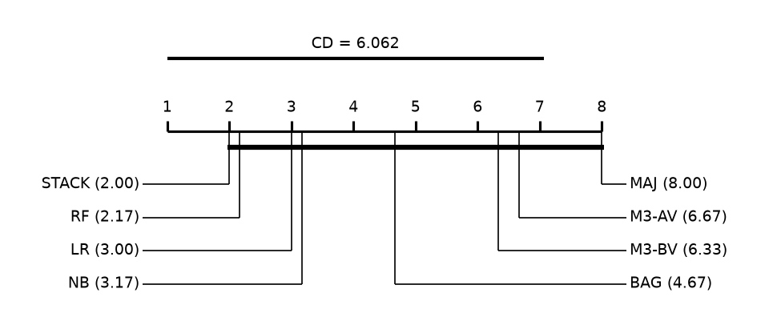

# Campagne 1 : analyse

- Résultats analysés : `C:\Users\GSI\Documents\Master Recherche\EXPERIMENTATION\PROTOCOLE_1\resultats\essai_local`
- Script d'analyse : commit `aabd81d96f52ea04b7faccbc51f0e93ab0cd04fe`, modifications non commitées : False
- Versions : scipy 1.18.1, numpy 2.5.0, pandas 3.0.3
- Date de l'analyse : 2026-11-18T10:32:20

**Campagne non concluante (3 jeux terminés < 15).** H8 à H10 ne reçoivent pas de verdict ; seuls les résultats descriptifs sont rapportés (DECISIONS.md).

## Anomalies de traçabilité

Signalées, non bloquantes : aucun pli n'est exclu pour cette raison.

Aucune.

Machines utilisées :

| processeur | plateforme | nb_plis |
|---|---|---|
| Intel64 Family 6 Model 78 Stepping 3, GenuineIntel | Windows-10-10.0.19045-SP0 | 30 |

## Jeux retenus (3)

iris, wine, zoo

## Jeux non retenus

Aucun.

## F1 macro par jeu (moyenne sur 10 plis)

Arrondie à 3 décimales ici ; valeurs exactes dans `f1_par_jeu.csv`.

| jeu | MAJ | M3-AV | M3-BV | STACK | LR | RF | NB | BAG |
|---|---|---|---|---|---|---|---|---|
| iris | 0.167 | 0.901 | 0.910 | 0.966 | 0.946 | 0.946 | 0.933 | 0.945 |
| wine | 0.190 | 0.939 | 0.912 | 0.963 | 0.951 | 0.956 | 0.957 | 0.939 |
| zoo | 0.102 | 0.495 | 0.547 | 0.816 | 0.891 | 0.911 | 0.891 | 0.673 |

## Friedman et Nemenyi (descriptif, sans verdict)

Friedman : chi2 = 18.172, p = 0.01122, N = 3 jeux, k = 8 méthodes. Nemenyi : CD = 3.031·√(k(k+1)/(6N)) = 6.062.

| methode | rang_moyen |
|---|---|
| STACK | 2.000 |
| RF | 2.167 |
| LR | 3.000 |
| NB | 3.167 |
| BAG | 4.667 |
| M3-BV | 6.333 |
| M3-AV | 6.667 |
| MAJ | 8.000 |

Groupes non distincts (rangs à moins de CD) : {STACK, RF, LR, NB, BAG, M3-BV, M3-AV, MAJ}

## Non-couverts et égalités de M3-AV et M3-BV

| jeu | taux_non_couverts_M3-AV | taux_non_couverts_M3-BV | taux_egalites_M3-AV | taux_egalites_M3-BV |
|---|---|---|---|---|
| iris | 0.007 | 0.007 | 0.000 | 0.000 |
| wine | 0.000 | 0.000 | 0.000 | 0.006 |
| zoo | 0.000 | 0.000 | 0.000 | 0.010 |

## Table 3 de Makhalova & Trnecka (indicative)

Table 3 non fournie (`donnees/table3_makhalova_trnecka.csv` absent) : comparaison non faite.
